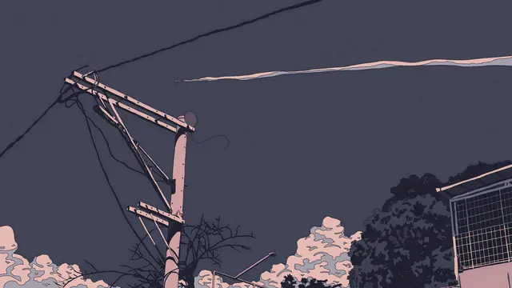
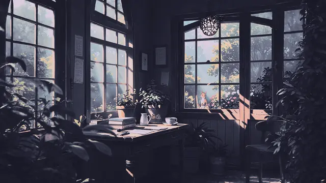
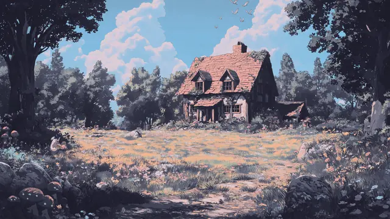
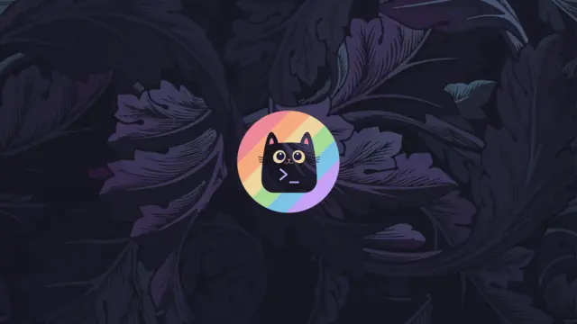
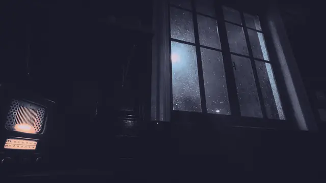
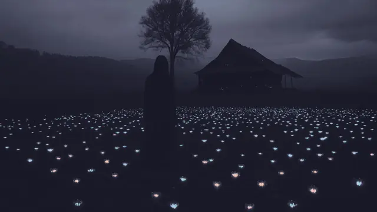
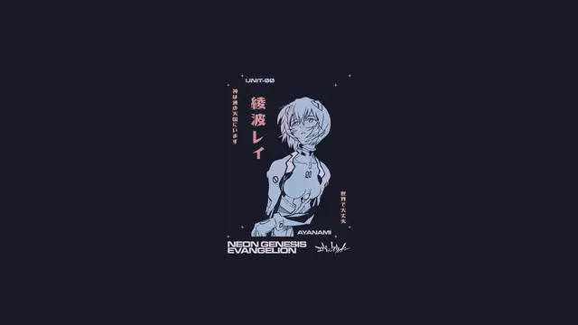
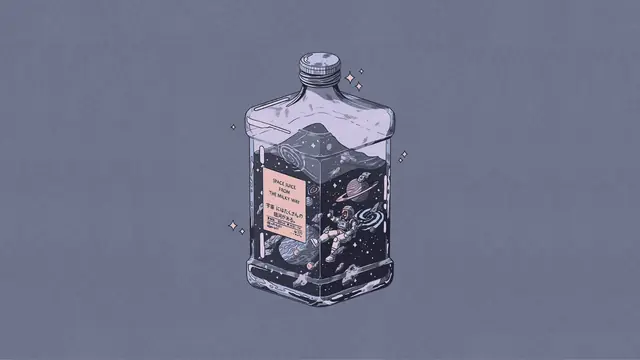
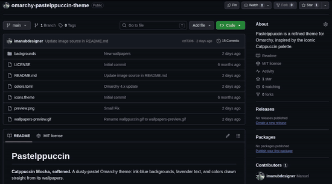

# 🌿 wallppuccin

A curated collection of wallpapers converted to the **Catppuccin Mocha** color palette.

Most of the wallpapers here are lightly retouched, above all to bring them to a standard 4K resolution (3840×2160), so they look sharp on any screen. Once in a while I also add small details that I draw myself.

Wallpapers are stored as WebP instead of PNG. To the eye nothing changes, but the files are about seven times smaller, which keeps the repository quick to clone. The JPEGs I left alone, because they were already light.

> 🍡 Want the matching Omarchy theme? Jump to **[Pastelppuccin](#-pastelppuccin)** ↓

## 🌌 Why Mocha?
Mocha is the darkest flavor of Catppuccin Mocha, designed for a cozy, high-contrast yet soft aesthetic. This repository aims to be the go-to place for Mocha lovers.

### 🖼️ Wallpapers Gallery (Mocha)

**207 wallpapers.** The most recent additions come first, so the newest ones are the first rows and returning visitors spot them right away. Every thumbnail is 640×360 and links to the full-resolution image.

<table>
  <tr>
    <td width="33%"><a href="https://codeberg.org/imanubdesigner/wallppuccin/media/branch/main/wallpapers/anime-girl-street-night-moody-look-desktop-wallpaper.jpg" target="_blank"></a></td>
    <td width="33%"><a href="https://codeberg.org/imanubdesigner/wallppuccin/media/branch/main/wallpapers/atmosphere-plant-natural_landscape-twig.webp" target="_blank"></a></td>
    <td width="33%"><a href="https://codeberg.org/imanubdesigner/wallppuccin/media/branch/main/wallpapers/genshin_impact-dehya-dunyarzad-hoyolab.webp" target="_blank"></a></td>
  </tr>
  <tr>
    <td width="33%"><a href="https://codeberg.org/imanubdesigner/wallppuccin/media/branch/main/wallpapers/girl-on-the-bad.webp" target="_blank"></a></td>
    <td width="33%"><a href="https://codeberg.org/imanubdesigner/wallppuccin/media/branch/main/wallpapers/img1.wallspic.com-windjammer-ship-sailing_ship.jpg" target="_blank"></a></td>
    <td width="33%"><a href="https://codeberg.org/imanubdesigner/wallppuccin/media/branch/main/wallpapers/outer_space-universe-astronomical_object-pink-purple.jpg" target="_blank"></a></td>
  </tr>
  <tr>
    <td width="33%"><a href="https://codeberg.org/imanubdesigner/wallppuccin/media/branch/main/wallpapers/reign_of_brayshaw-flower-lavender-aster-table.jpg" target="_blank"></a></td>
    <td width="33%"><a href="https://codeberg.org/imanubdesigner/wallppuccin/media/branch/main/wallpapers/wallhaven-212k56.jpg" target="_blank"></a></td>
    <td width="33%"><a href="https://codeberg.org/imanubdesigner/wallppuccin/media/branch/main/wallpapers/wallhaven-3q3j6y.jpg" target="_blank"></a></td>
  </tr>
  <tr>
    <td width="33%"><a href="https://codeberg.org/imanubdesigner/wallppuccin/media/branch/main/wallpapers/wallhaven-3q77p6.jpg" target="_blank"></a></td>
    <td width="33%"><a href="https://codeberg.org/imanubdesigner/wallppuccin/media/branch/main/wallpapers/wallhaven-5gxvv3.webp" target="_blank"></a></td>
    <td width="33%"><a href="https://codeberg.org/imanubdesigner/wallppuccin/media/branch/main/wallpapers/wallhaven-5y3g55.jpg" target="_blank"></a></td>
  </tr>
  <tr>
    <td width="33%"><a href="https://codeberg.org/imanubdesigner/wallppuccin/media/branch/main/wallpapers/wallhaven-6lpdjl.jpg" target="_blank"></a></td>
    <td width="33%"><a href="https://codeberg.org/imanubdesigner/wallppuccin/media/branch/main/wallpapers/wallhaven-7jlpqy.webp" target="_blank"></a></td>
    <td width="33%"><a href="https://codeberg.org/imanubdesigner/wallppuccin/media/branch/main/wallpapers/wallhaven-8g957j.webp" target="_blank"></a></td>
  </tr>
  <tr>
    <td width="33%"><a href="https://codeberg.org/imanubdesigner/wallppuccin/media/branch/main/wallpapers/wallhaven-9o8k9w.webp" target="_blank"></a></td>
    <td width="33%"><a href="https://codeberg.org/imanubdesigner/wallppuccin/media/branch/main/wallpapers/wallhaven-9ode5x.jpg" target="_blank"></a></td>
    <td width="33%"><a href="https://codeberg.org/imanubdesigner/wallppuccin/media/branch/main/wallpapers/wallhaven-9ogd61.jpg" target="_blank"></a></td>
  </tr>
  <tr>
    <td width="33%"><a href="https://codeberg.org/imanubdesigner/wallppuccin/media/branch/main/wallpapers/wallhaven-9ok7ok.jpg" target="_blank"></a></td>
    <td width="33%"><a href="https://codeberg.org/imanubdesigner/wallppuccin/media/branch/main/wallpapers/wallhaven-9orlxx.jpg" target="_blank"></a></td>
    <td width="33%"><a href="https://codeberg.org/imanubdesigner/wallppuccin/media/branch/main/wallpapers/wallhaven-d83owj.webp" target="_blank"></a></td>
  </tr>
  <tr>
    <td width="33%"><a href="https://codeberg.org/imanubdesigner/wallppuccin/media/branch/main/wallpapers/wallhaven-e861zk.webp" target="_blank"></a></td>
    <td width="33%"><a href="https://codeberg.org/imanubdesigner/wallppuccin/media/branch/main/wallpapers/wallhaven-e861zk-2.webp" target="_blank"></a></td>
    <td width="33%"><a href="https://codeberg.org/imanubdesigner/wallppuccin/media/branch/main/wallpapers/wallhaven-e861zk-3.webp" target="_blank"></a></td>
  </tr>
  <tr>
    <td width="33%"><a href="https://codeberg.org/imanubdesigner/wallppuccin/media/branch/main/wallpapers/wallhaven-exl918.jpg" target="_blank"></a></td>
    <td width="33%"><a href="https://codeberg.org/imanubdesigner/wallppuccin/media/branch/main/wallpapers/wallhaven-gw55p3.jpg" target="_blank"></a></td>
    <td width="33%"><a href="https://codeberg.org/imanubdesigner/wallppuccin/media/branch/main/wallpapers/wallhaven-gwmdmq.webp" target="_blank"></a></td>
  </tr>
  <tr>
    <td width="33%"><a href="https://codeberg.org/imanubdesigner/wallppuccin/media/branch/main/wallpapers/wallhaven-jek28w.jpg" target="_blank"></a></td>
    <td width="33%"><a href="https://codeberg.org/imanubdesigner/wallppuccin/media/branch/main/wallpapers/wallhaven-k8dxwq.jpg" target="_blank"></a></td>
    <td width="33%"><a href="https://codeberg.org/imanubdesigner/wallppuccin/media/branch/main/wallpapers/wallhaven-po7x3e.webp" target="_blank"></a></td>
  </tr>
  <tr>
    <td width="33%"><a href="https://codeberg.org/imanubdesigner/wallppuccin/media/branch/main/wallpapers/wallhaven-qrgexq.webp" target="_blank"></a></td>
    <td width="33%"><a href="https://codeberg.org/imanubdesigner/wallppuccin/media/branch/main/wallpapers/wallhaven-qrjq8l.jpg" target="_blank"></a></td>
    <td width="33%"><a href="https://codeberg.org/imanubdesigner/wallppuccin/media/branch/main/wallpapers/wallhaven-vpowxm.jpg" target="_blank"></a></td>
  </tr>
  <tr>
    <td width="33%"><a href="https://codeberg.org/imanubdesigner/wallppuccin/media/branch/main/wallpapers/wallhaven-w51g16.jpg" target="_blank"></a></td>
    <td width="33%"><a href="https://codeberg.org/imanubdesigner/wallppuccin/media/branch/main/wallpapers/wallhaven-w53vxp.webp" target="_blank"></a></td>
    <td width="33%"><a href="https://codeberg.org/imanubdesigner/wallppuccin/media/branch/main/wallpapers/wallhaven-w5doeq.webp" target="_blank"></a></td>
  </tr>
  <tr>
    <td width="33%"><a href="https://codeberg.org/imanubdesigner/wallppuccin/media/branch/main/wallpapers/wallhaven-yq26xl.jpg" target="_blank"></a></td>
    <td width="33%"><a href="https://codeberg.org/imanubdesigner/wallppuccin/media/branch/main/wallpapers/wallhaven-yq2q3k.jpg" target="_blank"></a></td>
    <td width="33%"><a href="https://codeberg.org/imanubdesigner/wallppuccin/media/branch/main/wallpapers/wallhaven-zpoeqg.jpg" target="_blank"></a></td>
  </tr>
  <tr>
    <td width="33%"><a href="https://codeberg.org/imanubdesigner/wallppuccin/media/branch/main/wallpapers/bn176-wallpaper.jpg" target="_blank"></a></td>
    <td width="33%"><a href="https://codeberg.org/imanubdesigner/wallppuccin/media/branch/main/wallpapers/dk375-wallpaper.cam.jpg" target="_blank"></a></td>
    <td width="33%"><a href="https://codeberg.org/imanubdesigner/wallppuccin/media/branch/main/wallpapers/dl882-wallpaper.cam.jpg" target="_blank"></a></td>
  </tr>
  <tr>
    <td width="33%"><a href="https://codeberg.org/imanubdesigner/wallppuccin/media/branch/main/wallpapers/enchanted-forest-mushroom-deer-pastel-dreamy-desktop-wallpaper.jpg" target="_blank"></a></td>
    <td width="33%"><a href="https://codeberg.org/imanubdesigner/wallppuccin/media/branch/main/wallpapers/eren-yeager-biting-hand-attack-on-titan-desktop-wallpaper.jpg" target="_blank"></a></td>
    <td width="33%"><a href="https://codeberg.org/imanubdesigner/wallppuccin/media/branch/main/wallpapers/ew630-wallpaper.cam.jpg" target="_blank"></a></td>
  </tr>
</table>

<details>
<summary><b>Show the remaining 162 wallpapers</b> · older additions</summary>

<table>
  <tr>
    <td width="33%"><a href="https://codeberg.org/imanubdesigner/wallppuccin/media/branch/main/wallpapers/fc158-wallpaper.cam.jpg" target="_blank"></a></td>
    <td width="33%"><a href="https://codeberg.org/imanubdesigner/wallppuccin/media/branch/main/wallpapers/fk840-wallpaper.cam.jpg" target="_blank"></a></td>
    <td width="33%"><a href="https://codeberg.org/imanubdesigner/wallppuccin/media/branch/main/wallpapers/fox-mask-girl-anime-noir-desktop-wallpaper.jpg" target="_blank"></a></td>
  </tr>
  <tr>
    <td width="33%"><a href="https://codeberg.org/imanubdesigner/wallppuccin/media/branch/main/wallpapers/gf762-wallpaper.jpg" target="_blank"></a></td>
    <td width="33%"><a href="https://codeberg.org/imanubdesigner/wallppuccin/media/branch/main/wallpapers/hi835-wallpaper.cam.jpg" target="_blank"></a></td>
    <td width="33%"><a href="https://codeberg.org/imanubdesigner/wallppuccin/media/branch/main/wallpapers/io682-wallpaper.cam.jpg" target="_blank"></a></td>
  </tr>
  <tr>
    <td width="33%"><a href="https://codeberg.org/imanubdesigner/wallppuccin/media/branch/main/wallpapers/ir160-wallpaper.cam.jpg" target="_blank"></a></td>
    <td width="33%"><a href="https://codeberg.org/imanubdesigner/wallppuccin/media/branch/main/wallpapers/iy773-wallpaper.cam.jpg" target="_blank"></a></td>
    <td width="33%"><a href="https://codeberg.org/imanubdesigner/wallppuccin/media/branch/main/wallpapers/jh428-wallpaper.cam.jpg" target="_blank"></a></td>
  </tr>
  <tr>
    <td width="33%"><a href="https://codeberg.org/imanubdesigner/wallppuccin/media/branch/main/wallpapers/jv145-wallpaper.cam.jpg" target="_blank"></a></td>
    <td width="33%"><a href="https://codeberg.org/imanubdesigner/wallppuccin/media/branch/main/wallpapers/kasane-teto-cozy-pink-anime-girl-desktop-wallpaper.jpg" target="_blank"></a></td>
    <td width="33%"><a href="https://codeberg.org/imanubdesigner/wallppuccin/media/branch/main/wallpapers/kasane-teto-pink-anime-portrait-desktop-wallpaper.jpg" target="_blank"></a></td>
  </tr>
  <tr>
    <td width="33%"><a href="https://codeberg.org/imanubdesigner/wallppuccin/media/branch/main/wallpapers/kawaii-girl-hello-kitty-christmas-bedroom-desktop-wallpaper.jpg" target="_blank"></a></td>
    <td width="33%"><a href="https://codeberg.org/imanubdesigner/wallppuccin/media/branch/main/wallpapers/li200-wallpaper.jpg" target="_blank"></a></td>
    <td width="33%"><a href="https://codeberg.org/imanubdesigner/wallppuccin/media/branch/main/wallpapers/oc191-wallpaper.cam.jpg" target="_blank"></a></td>
  </tr>
  <tr>
    <td width="33%"><a href="https://codeberg.org/imanubdesigner/wallppuccin/media/branch/main/wallpapers/on157-wallpaper.cam.jpg" target="_blank"></a></td>
    <td width="33%"><a href="https://codeberg.org/imanubdesigner/wallppuccin/media/branch/main/wallpapers/oq349-wallpaper.cam.jpg" target="_blank"></a></td>
    <td width="33%"><a href="https://codeberg.org/imanubdesigner/wallppuccin/media/branch/main/wallpapers/pc764-wallpaper.jpg" target="_blank"></a></td>
  </tr>
  <tr>
    <td width="33%"><a href="https://codeberg.org/imanubdesigner/wallppuccin/media/branch/main/wallpapers/pl663-wallpaper.cam.jpg" target="_blank"></a></td>
    <td width="33%"><a href="https://codeberg.org/imanubdesigner/wallppuccin/media/branch/main/wallpapers/power-chainsaw-man-neon-chaos-desktop-wallpaper.jpg" target="_blank"></a></td>
    <td width="33%"><a href="https://codeberg.org/imanubdesigner/wallppuccin/media/branch/main/wallpapers/qb332-wallpaper.jpg" target="_blank"></a></td>
  </tr>
  <tr>
    <td width="33%"><a href="https://codeberg.org/imanubdesigner/wallppuccin/media/branch/main/wallpapers/starry-sky-sad-anime-girl-aesthetic-night-desktop-wallpaper.jpg" target="_blank"></a></td>
    <td width="33%"><a href="https://codeberg.org/imanubdesigner/wallppuccin/media/branch/main/wallpapers/totoro-flower-crown-night-forest-aesthetic-desktop-wallpaper.jpg" target="_blank"></a></td>
    <td width="33%"><a href="https://codeberg.org/imanubdesigner/wallppuccin/media/branch/main/wallpapers/tx409-wallpaper.cam.jpg" target="_blank"></a></td>
  </tr>
  <tr>
    <td width="33%"><a href="https://codeberg.org/imanubdesigner/wallppuccin/media/branch/main/wallpapers/wj134-wallpaper.cam.jpg" target="_blank"></a></td>
    <td width="33%"><a href="https://codeberg.org/imanubdesigner/wallppuccin/media/branch/main/wallpapers/wt972-wallpaper.cam.jpg" target="_blank"></a></td>
    <td width="33%"><a href="https://codeberg.org/imanubdesigner/wallppuccin/media/branch/main/wallpapers/xa085-wallpaper.cam.jpg" target="_blank"></a></td>
  </tr>
  <tr>
    <td width="33%"><a href="https://codeberg.org/imanubdesigner/wallppuccin/media/branch/main/wallpapers/cozy-dreamy-room.jpg" target="_blank"></a></td>
    <td width="33%"><a href="https://codeberg.org/imanubdesigner/wallppuccin/media/branch/main/wallpapers/crimson-bloom-serenity.jpg" target="_blank"></a></td>
    <td width="33%"><a href="https://codeberg.org/imanubdesigner/wallppuccin/media/branch/main/wallpapers/ghibli-style-wallpaper.jpg" target="_blank"></a></td>
  </tr>
  <tr>
    <td width="33%"><a href="https://codeberg.org/imanubdesigner/wallppuccin/media/branch/main/wallpapers/jungle-cats-hideaway.jpg" target="_blank"></a></td>
    <td width="33%"><a href="https://codeberg.org/imanubdesigner/wallppuccin/media/branch/main/wallpapers/rainy-road-reverie.jpg" target="_blank"></a></td>
    <td width="33%"><a href="https://codeberg.org/imanubdesigner/wallppuccin/media/branch/main/wallpapers/wallhaven-5y3oj1.jpg" target="_blank"></a></td>
  </tr>
  <tr>
    <td width="33%"><a href="https://codeberg.org/imanubdesigner/wallppuccin/media/branch/main/wallpapers/wallhaven-qrppzl.jpg" target="_blank"></a></td>
    <td width="33%"><a href="https://codeberg.org/imanubdesigner/wallppuccin/media/branch/main/wallpapers/wallhaven-yq9or7.webp" target="_blank"></a></td>
    <td width="33%"><a href="https://codeberg.org/imanubdesigner/wallppuccin/media/branch/main/wallpapers/whispering-meadows-cottage.jpg" target="_blank"></a></td>
  </tr>
  <tr>
    <td width="33%"><a href="https://codeberg.org/imanubdesigner/wallppuccin/media/branch/main/wallpapers/white-cat-with-red-umbrella.jpg" target="_blank"></a></td>
    <td width="33%"><a href="https://codeberg.org/imanubdesigner/wallppuccin/media/branch/main/wallpapers/wildflower-meadows-wallpaper-3840x2160-flower-season-colorful-landscapes-29897.jpg" target="_blank"></a></td>
    <td width="33%"><a href="https://codeberg.org/imanubdesigner/wallppuccin/media/branch/main/wallpapers/angry-joker.jpg" target="_blank"></a></td>
  </tr>
  <tr>
    <td width="33%"><a href="https://codeberg.org/imanubdesigner/wallppuccin/media/branch/main/wallpapers/2xl.jpg" target="_blank"></a></td>
    <td width="33%"><a href="https://codeberg.org/imanubdesigner/wallppuccin/media/branch/main/wallpapers/4k-astronaut.jpg" target="_blank"></a></td>
    <td width="33%"><a href="https://codeberg.org/imanubdesigner/wallppuccin/media/branch/main/wallpapers/alpine-twilight.webp" target="_blank"></a></td>
  </tr>
  <tr>
    <td width="33%"><a href="https://codeberg.org/imanubdesigner/wallppuccin/media/branch/main/wallpapers/anime-girl-blue-hair.jpg" target="_blank"></a></td>
    <td width="33%"><a href="https://codeberg.org/imanubdesigner/wallppuccin/media/branch/main/wallpapers/Anime-Girl1.webp" target="_blank"></a></td>
    <td width="33%"><a href="https://codeberg.org/imanubdesigner/wallppuccin/media/branch/main/wallpapers/Anime-Girl2.webp" target="_blank"></a></td>
  </tr>
  <tr>
    <td width="33%"><a href="https://codeberg.org/imanubdesigner/wallppuccin/media/branch/main/wallpapers/Anime-Girl3.webp" target="_blank"></a></td>
    <td width="33%"><a href="https://codeberg.org/imanubdesigner/wallppuccin/media/branch/main/wallpapers/Anime-Girl4.webp" target="_blank"></a></td>
    <td width="33%"><a href="https://codeberg.org/imanubdesigner/wallppuccin/media/branch/main/wallpapers/Anime-Purple-eyes.webp" target="_blank"></a></td>
  </tr>
  <tr>
    <td width="33%"><a href="https://codeberg.org/imanubdesigner/wallppuccin/media/branch/main/wallpapers/Arcade_decay_red.webp" target="_blank"></a></td>
    <td width="33%"><a href="https://codeberg.org/imanubdesigner/wallppuccin/media/branch/main/wallpapers/arch-catppuccin.webp" target="_blank"></a></td>
    <td width="33%"><a href="https://codeberg.org/imanubdesigner/wallppuccin/media/branch/main/wallpapers/Arch-chan_to.webp" target="_blank"></a></td>
  </tr>
  <tr>
    <td width="33%"><a href="https://codeberg.org/imanubdesigner/wallppuccin/media/branch/main/wallpapers/beautiful-fantasy-landscape-desktop-wallpaper.jpg" target="_blank"></a></td>
    <td width="33%"><a href="https://codeberg.org/imanubdesigner/wallppuccin/media/branch/main/wallpapers/catppuccin.webp" target="_blank"></a></td>
    <td width="33%"><a href="https://codeberg.org/imanubdesigner/wallppuccin/media/branch/main/wallpapers/catppucin-Arch.jpg" target="_blank"></a></td>
  </tr>
  <tr>
    <td width="33%"><a href="https://codeberg.org/imanubdesigner/wallppuccin/media/branch/main/wallpapers/cflktkjnv9ig1.jpeg" target="_blank"></a></td>
    <td width="33%"><a href="https://codeberg.org/imanubdesigner/wallppuccin/media/branch/main/wallpapers/christmas-cybr.webp" target="_blank"></a></td>
    <td width="33%"><a href="https://codeberg.org/imanubdesigner/wallppuccin/media/branch/main/wallpapers/crimson-feathers.webp" target="_blank"></a></td>
  </tr>
  <tr>
    <td width="33%"><a href="https://codeberg.org/imanubdesigner/wallppuccin/media/branch/main/wallpapers/ember-eyes.webp" target="_blank"></a></td>
    <td width="33%"><a href="https://codeberg.org/imanubdesigner/wallppuccin/media/branch/main/wallpapers/fz570-wallpaper.cam.jpg" target="_blank"></a></td>
    <td width="33%"><a href="https://codeberg.org/imanubdesigner/wallppuccin/media/branch/main/wallpapers/gd5351no3g6e1.jpeg" target="_blank"></a></td>
  </tr>
  <tr>
    <td width="33%"><a href="https://codeberg.org/imanubdesigner/wallppuccin/media/branch/main/wallpapers/heart_original.webp" target="_blank"></a></td>
    <td width="33%"><a href="https://codeberg.org/imanubdesigner/wallppuccin/media/branch/main/wallpapers/in335-wallpaper.cam.jpg" target="_blank"></a></td>
    <td width="33%"><a href="https://codeberg.org/imanubdesigner/wallppuccin/media/branch/main/wallpapers/ink-splash-cat.webp" target="_blank"></a></td>
  </tr>
  <tr>
    <td width="33%"><a href="https://codeberg.org/imanubdesigner/wallppuccin/media/branch/main/wallpapers/ink-splash-feline.webp" target="_blank"></a></td>
    <td width="33%"><a href="https://codeberg.org/imanubdesigner/wallppuccin/media/branch/main/wallpapers/jupiter.webp" target="_blank"></a></td>
    <td width="33%"><a href="https://codeberg.org/imanubdesigner/wallppuccin/media/branch/main/wallpapers/kitty-catppuccin.webp" target="_blank"></a></td>
  </tr>
  <tr>
    <td width="33%"><a href="https://codeberg.org/imanubdesigner/wallppuccin/media/branch/main/wallpapers/latenr.jpeg" target="_blank"></a></td>
    <td width="33%"><a href="https://codeberg.org/imanubdesigner/wallppuccin/media/branch/main/wallpapers/Lofi%20-%20Study.webp" target="_blank"></a></td>
    <td width="33%"><a href="https://codeberg.org/imanubdesigner/wallppuccin/media/branch/main/wallpapers/Lowpoly_Street.webp" target="_blank"></a></td>
  </tr>
  <tr>
    <td width="33%"><a href="https://codeberg.org/imanubdesigner/wallppuccin/media/branch/main/wallpapers/naa0pr80msvg1.webp" target="_blank"></a></td>
    <td width="33%"><a href="https://codeberg.org/imanubdesigner/wallppuccin/media/branch/main/wallpapers/newsprint-peek.webp" target="_blank"></a></td>
    <td width="33%"><a href="https://codeberg.org/imanubdesigner/wallppuccin/media/branch/main/wallpapers/pttwus9ouzpg1.webp" target="_blank"></a></td>
  </tr>
  <tr>
    <td width="33%"><a href="https://codeberg.org/imanubdesigner/wallppuccin/media/branch/main/wallpapers/q2u24ei1qxlg1.jpeg" target="_blank"></a></td>
    <td width="33%"><a href="https://codeberg.org/imanubdesigner/wallppuccin/media/branch/main/wallpapers/qkreagwmmukg1.webp" target="_blank"></a></td>
    <td width="33%"><a href="https://codeberg.org/imanubdesigner/wallppuccin/media/branch/main/wallpapers/space-floating.jpg" target="_blank"></a></td>
  </tr>
  <tr>
    <td width="33%"><a href="https://codeberg.org/imanubdesigner/wallppuccin/media/branch/main/wallpapers/space.webp" target="_blank"></a></td>
    <td width="33%"><a href="https://codeberg.org/imanubdesigner/wallppuccin/media/branch/main/wallpapers/spire-peak.webp" target="_blank"></a></td>
    <td width="33%"><a href="https://codeberg.org/imanubdesigner/wallppuccin/media/branch/main/wallpapers/Street-1.webp" target="_blank"></a></td>
  </tr>
  <tr>
    <td width="33%"><a href="https://codeberg.org/imanubdesigner/wallppuccin/media/branch/main/wallpapers/Street-2.webp" target="_blank"></a></td>
    <td width="33%"><a href="https://codeberg.org/imanubdesigner/wallppuccin/media/branch/main/wallpapers/Study-table.webp" target="_blank"></a></td>
    <td width="33%"><a href="https://codeberg.org/imanubdesigner/wallppuccin/media/branch/main/wallpapers/sushi.jpg" target="_blank"></a></td>
  </tr>
  <tr>
    <td width="33%"><a href="https://codeberg.org/imanubdesigner/wallppuccin/media/branch/main/wallpapers/train.webp" target="_blank"></a></td>
    <td width="33%"><a href="https://codeberg.org/imanubdesigner/wallppuccin/media/branch/main/wallpapers/vixem0i4zbog1.webp" target="_blank"></a></td>
    <td width="33%"><a href="https://codeberg.org/imanubdesigner/wallppuccin/media/branch/main/wallpapers/wallhalla-75.jpg" target="_blank"></a></td>
  </tr>
  <tr>
    <td width="33%"><a href="https://codeberg.org/imanubdesigner/wallppuccin/media/branch/main/wallpapers/wallhaven-1p5l6g.jpg" target="_blank"></a></td>
    <td width="33%"><a href="https://codeberg.org/imanubdesigner/wallppuccin/media/branch/main/wallpapers/wallhaven-1p5mqv.jpg" target="_blank"></a></td>
    <td width="33%"><a href="https://codeberg.org/imanubdesigner/wallppuccin/media/branch/main/wallpapers/wallhaven-1q89e3.jpg" target="_blank"></a></td>
  </tr>
  <tr>
    <td width="33%"><a href="https://codeberg.org/imanubdesigner/wallppuccin/media/branch/main/wallpapers/wallhaven-1qq9y1.webp" target="_blank"></a></td>
    <td width="33%"><a href="https://codeberg.org/imanubdesigner/wallppuccin/media/branch/main/wallpapers/wallhaven-21ko5m.jpg" target="_blank"></a></td>
    <td width="33%"><a href="https://codeberg.org/imanubdesigner/wallppuccin/media/branch/main/wallpapers/wallhaven-2y3jzx.webp" target="_blank"></a></td>
  </tr>
  <tr>
    <td width="33%"><a href="https://codeberg.org/imanubdesigner/wallppuccin/media/branch/main/wallpapers/wallhaven-2y625y.webp" target="_blank"></a></td>
    <td width="33%"><a href="https://codeberg.org/imanubdesigner/wallppuccin/media/branch/main/wallpapers/wallhaven-3l72e3.webp" target="_blank"></a></td>
    <td width="33%"><a href="https://codeberg.org/imanubdesigner/wallppuccin/media/branch/main/wallpapers/wallhaven-3q9qky.webp" target="_blank"></a></td>
  </tr>
  <tr>
    <td width="33%"><a href="https://codeberg.org/imanubdesigner/wallppuccin/media/branch/main/wallpapers/wallhaven-3qzvr6.webp" target="_blank"></a></td>
    <td width="33%"><a href="https://codeberg.org/imanubdesigner/wallppuccin/media/branch/main/wallpapers/wallhaven-5g9z53.jpg" target="_blank"></a></td>
    <td width="33%"><a href="https://codeberg.org/imanubdesigner/wallppuccin/media/branch/main/wallpapers/wallhaven-5yy2o8.webp" target="_blank"></a></td>
  </tr>
  <tr>
    <td width="33%"><a href="https://codeberg.org/imanubdesigner/wallppuccin/media/branch/main/wallpapers/wallhaven-7j6k53.jpg" target="_blank"></a></td>
    <td width="33%"><a href="https://codeberg.org/imanubdesigner/wallppuccin/media/branch/main/wallpapers/wallhaven-7j6xry.jpg" target="_blank"></a></td>
    <td width="33%"><a href="https://codeberg.org/imanubdesigner/wallppuccin/media/branch/main/wallpapers/wallhaven-7jg7rv.jpg" target="_blank"></a></td>
  </tr>
  <tr>
    <td width="33%"><a href="https://codeberg.org/imanubdesigner/wallppuccin/media/branch/main/wallpapers/wallhaven-7jxj1o.webp" target="_blank"></a></td>
    <td width="33%"><a href="https://codeberg.org/imanubdesigner/wallppuccin/media/branch/main/wallpapers/wallhaven-7pdl1v.webp" target="_blank"></a></td>
    <td width="33%"><a href="https://codeberg.org/imanubdesigner/wallppuccin/media/branch/main/wallpapers/wallhaven-7pdvmv.jpg" target="_blank"></a></td>
  </tr>
  <tr>
    <td width="33%"><a href="https://codeberg.org/imanubdesigner/wallppuccin/media/branch/main/wallpapers/wallhaven-7pzqje.jpg" target="_blank"></a></td>
    <td width="33%"><a href="https://codeberg.org/imanubdesigner/wallppuccin/media/branch/main/wallpapers/wallhaven-8gegkj.webp" target="_blank"></a></td>
    <td width="33%"><a href="https://codeberg.org/imanubdesigner/wallppuccin/media/branch/main/wallpapers/wallhaven-8ggqqj.jpg" target="_blank"></a></td>
  </tr>
  <tr>
    <td width="33%"><a href="https://codeberg.org/imanubdesigner/wallppuccin/media/branch/main/wallpapers/wallhaven-8ggwz.jpg" target="_blank"></a></td>
    <td width="33%"><a href="https://codeberg.org/imanubdesigner/wallppuccin/media/branch/main/wallpapers/wallhaven-8gkq8o.webp" target="_blank"></a></td>
    <td width="33%"><a href="https://codeberg.org/imanubdesigner/wallppuccin/media/branch/main/wallpapers/wallhaven-96mlzd.webp" target="_blank"></a></td>
  </tr>
  <tr>
    <td width="33%"><a href="https://codeberg.org/imanubdesigner/wallppuccin/media/branch/main/wallpapers/wallhaven-9dkgyx.webp" target="_blank"></a></td>
    <td width="33%"><a href="https://codeberg.org/imanubdesigner/wallppuccin/media/branch/main/wallpapers/wallhaven-9dkywx.webp" target="_blank"></a></td>
    <td width="33%"><a href="https://codeberg.org/imanubdesigner/wallppuccin/media/branch/main/wallpapers/wallhaven-9o8wv1.jpg" target="_blank"></a></td>
  </tr>
  <tr>
    <td width="33%"><a href="https://codeberg.org/imanubdesigner/wallppuccin/media/branch/main/wallpapers/wallhaven-9oojp8.webp" target="_blank"></a></td>
    <td width="33%"><a href="https://codeberg.org/imanubdesigner/wallppuccin/media/branch/main/wallpapers/wallhaven-d616vj.jpg" target="_blank"></a></td>
    <td width="33%"><a href="https://codeberg.org/imanubdesigner/wallppuccin/media/branch/main/wallpapers/wallhaven-d6l58m.jpg" target="_blank"></a></td>
  </tr>
  <tr>
    <td width="33%"><a href="https://codeberg.org/imanubdesigner/wallppuccin/media/branch/main/wallpapers/wallhaven-d883yg.webp" target="_blank"></a></td>
    <td width="33%"><a href="https://codeberg.org/imanubdesigner/wallppuccin/media/branch/main/wallpapers/wallhaven-e88pqw.webp" target="_blank"></a></td>
    <td width="33%"><a href="https://codeberg.org/imanubdesigner/wallppuccin/media/branch/main/wallpapers/wallhaven-e8oqkw.jpg" target="_blank"></a></td>
  </tr>
  <tr>
    <td width="33%"><a href="https://codeberg.org/imanubdesigner/wallppuccin/media/branch/main/wallpapers/wallhaven-gp3oll.webp" target="_blank"></a></td>
    <td width="33%"><a href="https://codeberg.org/imanubdesigner/wallppuccin/media/branch/main/wallpapers/wallhaven-gpm837.webp" target="_blank"></a></td>
    <td width="33%"><a href="https://codeberg.org/imanubdesigner/wallppuccin/media/branch/main/wallpapers/wallhaven-gpo8p3.jpg" target="_blank"></a></td>
  </tr>
  <tr>
    <td width="33%"><a href="https://codeberg.org/imanubdesigner/wallppuccin/media/branch/main/wallpapers/wallhaven-gpqmkd.webp" target="_blank"></a></td>
    <td width="33%"><a href="https://codeberg.org/imanubdesigner/wallppuccin/media/branch/main/wallpapers/wallhaven-gpy893.webp" target="_blank"></a></td>
    <td width="33%"><a href="https://codeberg.org/imanubdesigner/wallppuccin/media/branch/main/wallpapers/wallhaven-gw5gjd.webp" target="_blank"></a></td>
  </tr>
  <tr>
    <td width="33%"><a href="https://codeberg.org/imanubdesigner/wallppuccin/media/branch/main/wallpapers/wallhaven-gw5wyl.webp" target="_blank"></a></td>
    <td width="33%"><a href="https://codeberg.org/imanubdesigner/wallppuccin/media/branch/main/wallpapers/wallhaven-k875o6.webp" target="_blank"></a></td>
    <td width="33%"><a href="https://codeberg.org/imanubdesigner/wallppuccin/media/branch/main/wallpapers/wallhaven-k88p51.webp" target="_blank"></a></td>
  </tr>
  <tr>
    <td width="33%"><a href="https://codeberg.org/imanubdesigner/wallppuccin/media/branch/main/wallpapers/wallhaven-kxo68q.jpg" target="_blank"></a></td>
    <td width="33%"><a href="https://codeberg.org/imanubdesigner/wallppuccin/media/branch/main/wallpapers/wallhaven-kxqv8q.webp" target="_blank"></a></td>
    <td width="33%"><a href="https://codeberg.org/imanubdesigner/wallppuccin/media/branch/main/wallpapers/wallhaven-kxyj5d.webp" target="_blank"></a></td>
  </tr>
  <tr>
    <td width="33%"><a href="https://codeberg.org/imanubdesigner/wallppuccin/media/branch/main/wallpapers/wallhaven-l88qwy.webp" target="_blank"></a></td>
    <td width="33%"><a href="https://codeberg.org/imanubdesigner/wallppuccin/media/branch/main/wallpapers/wallhaven-l8exrr.jpg" target="_blank"></a></td>
    <td width="33%"><a href="https://codeberg.org/imanubdesigner/wallppuccin/media/branch/main/wallpapers/wallhaven-lyz9xp.jpg" target="_blank"></a></td>
  </tr>
  <tr>
    <td width="33%"><a href="https://codeberg.org/imanubdesigner/wallppuccin/media/branch/main/wallpapers/wallhaven-m3kggk.webp" target="_blank"></a></td>
    <td width="33%"><a href="https://codeberg.org/imanubdesigner/wallppuccin/media/branch/main/wallpapers/wallhaven-o5ozx9.jpg" target="_blank"></a></td>
    <td width="33%"><a href="https://codeberg.org/imanubdesigner/wallppuccin/media/branch/main/wallpapers/wallhaven-o5pdel.webp" target="_blank"></a></td>
  </tr>
  <tr>
    <td width="33%"><a href="https://codeberg.org/imanubdesigner/wallppuccin/media/branch/main/wallpapers/wallhaven-o5pegl.jpg" target="_blank"></a></td>
    <td width="33%"><a href="https://codeberg.org/imanubdesigner/wallppuccin/media/branch/main/wallpapers/wallhaven-o5w7x9.webp" target="_blank"></a></td>
    <td width="33%"><a href="https://codeberg.org/imanubdesigner/wallppuccin/media/branch/main/wallpapers/wallhaven-og1775.jpg" target="_blank"></a></td>
  </tr>
  <tr>
    <td width="33%"><a href="https://codeberg.org/imanubdesigner/wallppuccin/media/branch/main/wallpapers/wallhaven-ogd2e5.webp" target="_blank"></a></td>
    <td width="33%"><a href="https://codeberg.org/imanubdesigner/wallppuccin/media/branch/main/wallpapers/wallhaven-ogdzd5.webp" target="_blank"></a></td>
    <td width="33%"><a href="https://codeberg.org/imanubdesigner/wallppuccin/media/branch/main/wallpapers/wallhaven-p91rgj.jpg" target="_blank"></a></td>
  </tr>
  <tr>
    <td width="33%"><a href="https://codeberg.org/imanubdesigner/wallppuccin/media/branch/main/wallpapers/wallhaven-p9e8y9.webp" target="_blank"></a></td>
    <td width="33%"><a href="https://codeberg.org/imanubdesigner/wallppuccin/media/branch/main/wallpapers/wallhaven-polymm.webp" target="_blank"></a></td>
    <td width="33%"><a href="https://codeberg.org/imanubdesigner/wallppuccin/media/branch/main/wallpapers/wallhaven-qrgvll.webp" target="_blank"></a></td>
  </tr>
  <tr>
    <td width="33%"><a href="https://codeberg.org/imanubdesigner/wallppuccin/media/branch/main/wallpapers/wallhaven-rqox9m.webp" target="_blank"></a></td>
    <td width="33%"><a href="https://codeberg.org/imanubdesigner/wallppuccin/media/branch/main/wallpapers/wallhaven-rqqdlq.jpg" target="_blank"></a></td>
    <td width="33%"><a href="https://codeberg.org/imanubdesigner/wallppuccin/media/branch/main/wallpapers/wallhaven-rrme1w.webp" target="_blank"></a></td>
  </tr>
  <tr>
    <td width="33%"><a href="https://codeberg.org/imanubdesigner/wallppuccin/media/branch/main/wallpapers/wallhaven-vpzjo5.jpg" target="_blank"></a></td>
    <td width="33%"><a href="https://codeberg.org/imanubdesigner/wallppuccin/media/branch/main/wallpapers/wallhaven-vq2erp.webp" target="_blank"></a></td>
    <td width="33%"><a href="https://codeberg.org/imanubdesigner/wallppuccin/media/branch/main/wallpapers/wallhaven-vqp5e8.webp" target="_blank"></a></td>
  </tr>
  <tr>
    <td width="33%"><a href="https://codeberg.org/imanubdesigner/wallppuccin/media/branch/main/wallpapers/wallhaven-w51qe7.webp" target="_blank"></a></td>
    <td width="33%"><a href="https://codeberg.org/imanubdesigner/wallppuccin/media/branch/main/wallpapers/wallhaven-we2826.jpg" target="_blank"></a></td>
    <td width="33%"><a href="https://codeberg.org/imanubdesigner/wallppuccin/media/branch/main/wallpapers/wallhaven-we98vp.webp" target="_blank"></a></td>
  </tr>
  <tr>
    <td width="33%"><a href="https://codeberg.org/imanubdesigner/wallppuccin/media/branch/main/wallpapers/wallhaven-x6pd8z.jpg" target="_blank"></a></td>
    <td width="33%"><a href="https://codeberg.org/imanubdesigner/wallppuccin/media/branch/main/wallpapers/wallhaven-xe515l.jpg" target="_blank"></a></td>
    <td width="33%"><a href="https://codeberg.org/imanubdesigner/wallppuccin/media/branch/main/wallpapers/wallhaven-xek5md.webp" target="_blank"></a></td>
  </tr>
  <tr>
    <td width="33%"><a href="https://codeberg.org/imanubdesigner/wallppuccin/media/branch/main/wallpapers/wallhaven-yqev5d.jpg" target="_blank"></a></td>
    <td width="33%"><a href="https://codeberg.org/imanubdesigner/wallppuccin/media/branch/main/wallpapers/wallhaven-yqmqk7.webp" target="_blank"></a></td>
    <td width="33%"><a href="https://codeberg.org/imanubdesigner/wallppuccin/media/branch/main/wallpapers/wallhaven-yqqyol.webp" target="_blank"></a></td>
  </tr>
  <tr>
    <td width="33%"><a href="https://codeberg.org/imanubdesigner/wallppuccin/media/branch/main/wallpapers/wallhaven-zpp6zg.jpg" target="_blank"></a></td>
    <td width="33%"><a href="https://codeberg.org/imanubdesigner/wallppuccin/media/branch/main/wallpapers/wallpaper1.webp" target="_blank"></a></td>
    <td width="33%"><a href="https://codeberg.org/imanubdesigner/wallppuccin/media/branch/main/wallpapers/Wet-Road.jpg" target="_blank"></a></td>
  </tr>
</table>

</details>

## 🍡 Pastelppuccin

**[Pastelppuccin](https://github.com/imanubdesigner/omarchy-pastelppuccin-theme)** is the matching Omarchy theme — Catppuccin Mocha, softened: ink-blue backgrounds, lavender text, and colors drawn straight from these wallpapers.

```bash
omarchy theme install https://github.com/imanubdesigner/omarchy-pastelppuccin-theme
```

<p align="center">
  
</p>

## 🛠️ Conversion Details
All images are processed to match the Catppuccin Mocha Palette hex codes:
| Preview | Color Name | Hex |
| :---: | :--- | :--- |
|  | **Rosewater** | `#F5E0DC` |
|  | **Flamingo** | `#F2CDCD` |
|  | **Pink** | `#F5C2E7` |
|  | **Mauve** | `#CBA6F7` |
|  | **Red** | `#F38BA8` |
|  | **Peach** | `#FAB387` |
|  | **Yellow** | `#F9E2AF` |
|  | **Green** | `#A6E3A1` |
|  | **Teal** | `#94E2D5` |
|  | **Sky** | `#89DCEB` |
|  | **Blue** | `#89B4FA` |
|  | **Lavender** | `#B4BEFE` |
|  | **Text** | `#CDD6F4` |
|  | **Base** | `#1E1E2E` |
|  | **Mantle** | `#181825` |
|  | **Crust** | `#11111B` |

## 🔗 Credits
- Colors by [Catppuccin](https://github.com/catppuccin/catppuccin).
- Original images mainly from [Wallhaven](https://wallhaven.cc), plus other sources I come across while browsing the web.
